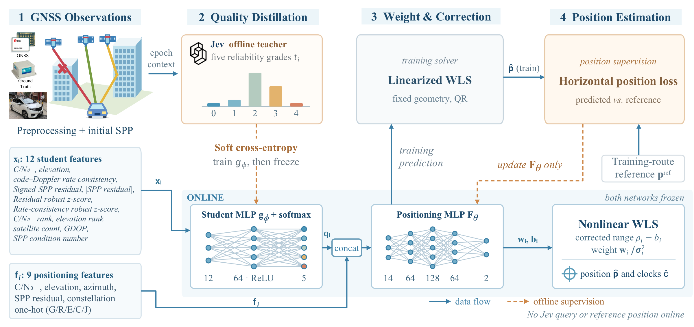
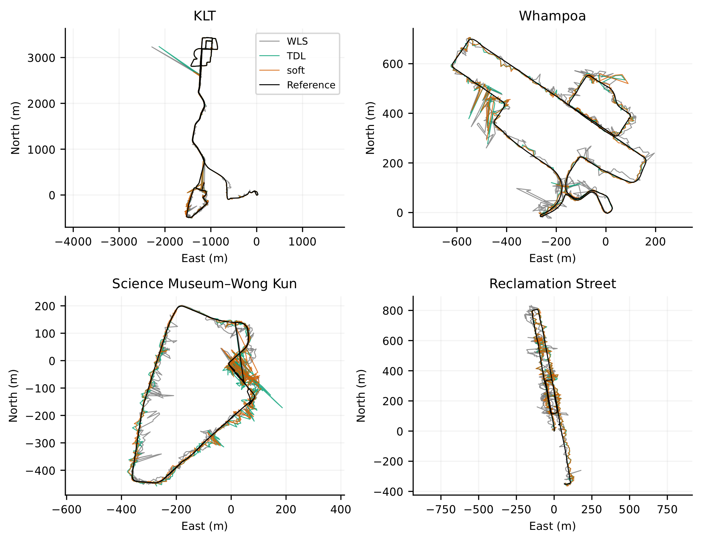

# JevGNSS

<p align="center">
  
</p>

**Teacher-Distilled Observation Quality for Learned GNSS Weighting and Correction in Urban Canyons.**

**Project page:** <https://jevgnss-preview-j5mmb4e4dq-de.a.run.app/>

**Dataset:** <https://www.dropbox.com/t/NgR7Z9O3UbMf2v2n>

**JevGNSS** distills five-level observation-quality judgments from an offline teacher into a 1,157-parameter student. A positioning network uses that student to predict observation weights and pseudorange corrections, and nonlinear weighted least squares computes the position. The teacher is used only during training. Inference uses local GNSS features.

The project page replays four urban routes in Hong Kong and seven positioning methods. The dataset contains the rover observations, ground truth, Jev labels, the teacher question and responses, and the trained checkpoints. This repository is the code that reproduces the frozen paper results. It does not contain the dataset.

**Authors:** Yixin Gao\*, Ruijie Xu\*, Yingying Wang, Feng Huang, and Weisong Wen, Department of Aeronautical and Aviation Engineering, The Hong Kong Polytechnic University.

\* Equal contribution.

**Contact:** [Yixin Gao](mailto:yixin.gao@connect.polyu.hk), [Ruijie Xu](mailto:ruijie.xu@connect.polyu.hk), [Yingying Wang](mailto:ying5wang@polyu.edu.hk), [Feng Huang](mailto:darren-f.huang@connect.polyu.hk), [Weisong Wen](mailto:welson.wen@polyu.edu.hk).

## System pipeline


The system has four stages.

- **GNSS observations.** Raw measurements are preprocessed and an initial single-point solution is formed. Twelve online features train the student. Nine features, extended by the five student outputs, enter the positioning network.
- **Quality distillation.** An offline Jev teacher assigns a five-level distribution to each observation. Soft cross-entropy trains the student, which is then frozen.
- **Weight and correction.** The positioning network is trained through a fixed-geometry linearized solver. The position loss uses the reference trajectory. That reference is not an input at inference.
- **Position estimation.** Both networks stay frozen. Nonlinear weighted least squares returns the position and the receiver clocks. No teacher query and no reference position are used online.

## Results

<p align="center">
  
</p>

Gray is physical WLS, teal is 9-input TDL-GNSS, orange is Soft Jev, and black is the reference.

Among the methods drawn here, Soft Jev has the lowest route-averaged horizontal RMSE: 16.68 m, compared with 19.31 m for TDL-GNSS and 27.22 m for physical WLS. That is 38.7% below WLS and 13.6% below TDL-GNSS, at 99.2% availability. Under the same network, the soft quality channel is also 10.5% below a null prior (95% CI [−3.35, −0.55] m).

| Method | Role |
|---|---|
| Physical WLS | Physical-variance baseline |
| GNC-TLS | Continuous robust reweighting |
| Residual FDE | Hard exclusion after a residual test |
| 9-input TDL-GNSS | Learned baseline without Jev |
| Null prior | Same 14-input network, five extra channels fixed at zero |
| Hard Jev | One-hot vector at the frozen student's argmax |
| Soft Jev | Full five-level student distribution |

The student is `12 → 64 → ReLU → 5` with 1,157 parameters. The 9-input TDL network has 17,346 parameters. The 14-input positioning networks have 17,666 trainable parameters. The student stays frozen while the positioning network is trained.

| Route | Sequence ID | Date |
|---|---|---|
| Hung Hom–Kowloon Tong | `klt-20210610` | 10 Jun 2021 |
| Whampoa | `whampoa-20210714` | 14 Jul 2021 |
| Science Museum | `science-museum-wongkun-20260630` | 30 Jun 2026 |
| Reclamation St | `reclamation-street-20260630` | 30 Jun 2026 |

## Run

Python 3.10 or newer is required. The commands below read a processed asset directory. That directory is separate from the public dataset linked above.

```bash
python3 -m venv .venv
source .venv/bin/activate
pip install -e '.[test]'
python scripts/reproduce.py --mode smoke --assets /path/to/processed-assets
python scripts/reproduce.py --mode evaluate --assets /path/to/processed-assets
```

`smoke` checks file hashes, the four-route whitelist, row counts, and the frozen checkpoints.

`evaluate` recomputes the registered metrics and replays nonlinear weighted least squares from the frozen per-observation weights and corrections. Coordinates must agree within 0.1 mm. Metrics must agree with `expected/metrics.json` within `1e-6`. The report is written to `results/paper-v1/`.

Details are in [DATA](docs/DATA.md), [METHOD](docs/METHOD.md), [REPRODUCE](docs/REPRODUCE.md), and [RESULTS](docs/RESULTS.md).

## Paper

```bibtex
@article{gao2026jevgnss,
  title   = {Teacher-Distilled Observation Quality for Learned GNSS Weighting and Correction in Urban Canyons},
  author  = {Gao, Yixin and Xu, Ruijie and Wang, Yingying and Huang, Feng and Wen, Weisong},
  year    = {2026}
}
```

## Acknowledgements

The 9-input baseline follows [TDL-GNSS](https://github.com/ebhrz/TDL-GNSS). The robust reweighting step adapts [GNC-and-ADAPT](https://github.com/MIT-SPARK/GNC-and-ADAPT). The residual exclusion test follows the idea used in [gnss_lib_py](https://github.com/Stanford-NavLab/gnss_lib_py). KLT observations come from [KLTDataset](https://github.com/ebhrz/KLTDataset). Whampoa observations come from [UrbanNav](https://github.com/IPNL-POLYU/UrbanNavDataset).
